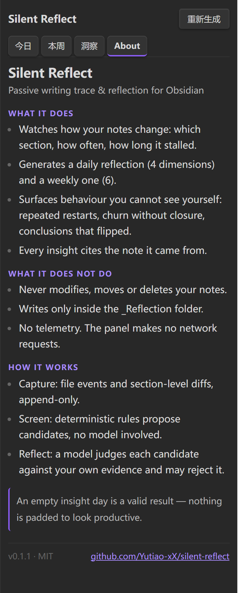

# Silent Reflect

### 被动式写作痕迹记录与复盘

> 静默记录你怎么写，然后把你自己看不见的东西还给你。
> 只读、不打扰、绝不修改你的原始笔记。

[English](README.md) · 中文

---



## 为什么需要它

你在笔记里写下了成千上万字，却很少回头看自己的想法是怎么演变的。
你想养成复盘习惯，但坚持几周就断了。
你试过各种 AI 整理工具，却怕它们改你的文件夹结构、重写你的笔记。

**Silent Reflect 的解法是「只观察，不编辑」。** 它读你写的东西，记录每个笔记随时间怎么变，然后生成结构化的日复盘或周复盘。原始笔记永远不被触碰——这个承诺由代码强制，不是写在文档里。

---

## 和同类不一样在哪

大多数 AI 笔记工具总结你写了什么。那是回声——你写的时候已经知道了。
Silent Reflect 看的是**行为**：哪一节被你反复改、哪个待办挂了十一天没动、哪个结论悄悄翻了。

| | 普通 AI 笔记插件 | Silent Reflect |
| :-- | :-- | :-- |
| 输入 | 你喂素材给它 | 你的写作行为 |
| 需要你做什么 | 写 prompt、敲命令 | 什么都不用 |
| 原始笔记 | 重新打标签、重构结构 | 严格只读 |
| 产出 | 内容摘要 | 行为洞察，**可能为空** |

**空结果是合法结果。** 没有值得说的事，洞察层就留空，不硬凑。

---

## 功能

| 功能 | 说明 |
| :-- | :-- |
| 🤫 **完全被动采集** | 只监听文件事件。无弹窗、无通知、不打断写作。 |
| 🔒 **严格只读** | 写入被硬性限制在 `_Reflection/`。越界写入会在运行时断言处直接抛错。 |
| 🧩 **章节级改动追踪** | 记录「哪一节变了」，不只是「文件变了」。这是洞察成立的前提。 |
| 📅 **日复盘 / 周复盘** | 日 4 个维度；周 6 个（多出「思考轨迹」和「未闭环项」）。 |
| 🧠 **带自我否决的洞察层** | 每条候选都要过判定；证据不足的直接丢弃，并写明理由。 |
| 👁️ **侧边栏面板** | 三个 tab（今日 / 本周 / 洞察），`[[双链]]` 可点回原文，可一键重新生成。 |
| 🤖 **AI 可选** | 采集和筛选完全不需要模型。用模型是可选动作，配自己的 API Key。 |
| 🎨 **原生主题** | 只用 Obsidian CSS 变量，自动跟随明暗与自定义主题。 |

---

## 工作原理

一条原则：**只观测，不干预。**

1. **采集** — 把文件事件和章节级差异追加到 `_Reflection/_events/YYYY-MM-DD.jsonl`。只追加，永不改写。
2. **筛选** — 确定性规则（不调模型）筛出候选：停滞、反复重开、只改不收尾、跨时间的结论反转。
3. **复盘** — 模型针对每条候选、只用你的证据做判定，可以否决。
4. **查看** — 侧边栏渲染结果，链接跳回原文。

引擎跑在 Obsidian 之外（Node CLI），插件只是读和显示的薄壳。

**为什么拆开：** 插件只在 Obsidian 打开时存在，而被动记录必须在你不场时也发生，所以生成交给系统计划任务。

---

## 快速开始

### 1. 引擎

插件只负责展示，不负责生成。先准备含 `run.mjs` 的引擎目录，跑一次：

```powershell
node C:\path\to\engine\run.mjs --vault "C:\path\to\your\vault"
```

产出写到 `<vault>/_Reflection/`。

### 2. 插件

把 `main.js`、`manifest.json`、`styles.css` 放进：

```
<vault>/.obsidian/plugins/silent-reflect/
```

然后在 设置 → 第三方插件 里启用 **Silent Reflect**。

### 3. 配置

设置 → Silent Reflect：

| 项 | 说明 |
| :-- | :-- |
| 引擎目录 | `run.mjs` 所在目录 |
| Node 路径 | 从图形界面启动的 Obsidian 通常找不到 node，填绝对路径 |
| 重新生成范围 | 日复盘 / 周复盘 |

---

## 隐私

- 插件不发起任何网络请求，不上传任何内容。
- 引擎只读 `.md`；唯一可写目录是 `_Reflection/`（运行时断言）。
- 调用模型时只发送候选条目和对应节选，不整库上传。
- 无遥测、无统计、无隐藏收集。

---

## 平台支持

| 组件 | Windows | macOS / Linux |
| :-- | :-- | :-- |
| 插件 | ✅ | ✅（仅桌面端） |
| 引擎（Node 脚本） | ✅ | ✅ |
| 定时生成 | ✅（计划任务） | ⚠️ 尚未打包，需自行配 cron / launchd |

移动端不支持：没有 `adapter.basePath`，也无法启动子进程。

---

## 已知限制

- 界面目前只有中文；复盘正文跟随你笔记的语言。
- 「重新生成」是同步等待（最长 5 分钟），期间按钮禁用。
- **不自动补生成**：22:00 时机器关着，那天就不会补。
- 一个引擎实例对应一个 vault。

---

## 反馈

- Bug：[Issue](https://github.com/Yutiao-xX/silent-reflect/issues)
- 想法：[Discussion](https://github.com/Yutiao-xX/silent-reflect/discussions)

## 许可

MIT
